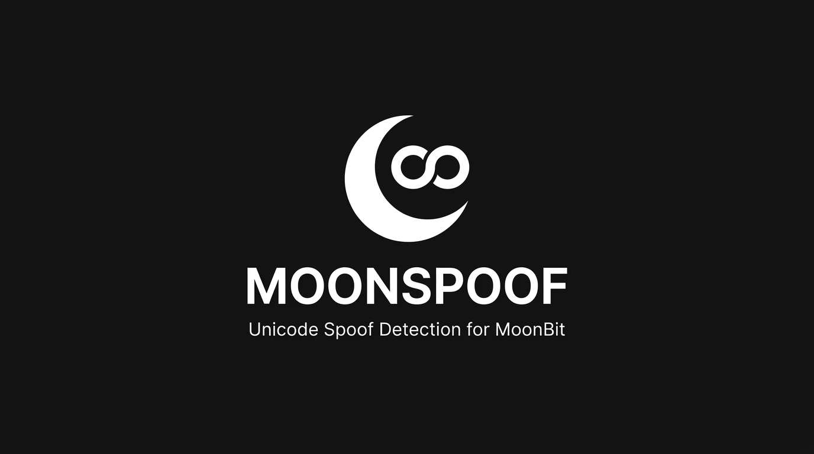

<p align="center">
  
</p>

<p align="center">
  
  
  
  
  <a href="LICENSE"></a>
  
</p>

<p align="center">
  Standard-compliant Unicode spoof detection and visual confusable identifier security for MoonBit.
</p>

<p align="center">
  <a href="docs/README_zh.md"><strong>简体中文文档</strong></a> ·
  <a href="#quickstart">Quickstart</a> ·
  <a href="docs/API_SPECIFICATION.md">API Specification</a> ·
  <a href="docs/ARCHITECTURE.md">Architecture</a> ·
  <a href="docs/SPECIFICATION.md">UTS #39 Compliance</a>
</p>

---

## Visual Confusables, Identified with Precision

| Standard-Driven Skeleton | Script & Restriction Analysis | High-Throughput Batch Scanning |
| :--- | :--- | :--- |
| Strict UTS #39 Confusable Skeleton transformation | Automated Script and Script_Extensions resolution | Hash-indexed skeleton bucketing in O(N) time |
| Distinguishes visual confusable from string equality | Multi-script isolation and context-aware grading | Batch username collision grouping without O(N^2) load |
| Covers Cyrillic, Greek, Latin, Han, Kana, and Hangul | Full detection of zero-width and bidirectional controls | Zero dependencies, targeting WebAssembly, JS, and Native |

MoonSpoof evaluates identifiers against standard Unicode Technical Standard #39 security profiles. It accurately distinguishes between benign multilingual identifiers (such as CJK domain names) and malicious cross-script visual masquerading (such as substituting Latin characters with visually identical Cyrillic glyphs).

---

## Choose Your Integration Mode

**Library Engine** — Import directly into MoonBit applications for username registration, package managers, and token validators.

**CLI Utility** — Audit identifier lists and inspect suspicious tokens with formatted terminal diagnostics.

**WebAssembly Playground** — Embed inside browser security consoles with zero-latency client-side execution.

```powershell
# Run the built-in CLI demonstration
moon run cmd/main
```

---

## Quickstart

### 1. Add Dependency

Declare in `moon.mod`:

```moonbit
import {
  "Sidney-sunny/moonspoof" @lib,
}
```

### 2. Basic Confusable Comparison

```moonbit
let authentic = "paypal"
let spoofed = "p\u0430ypal" // Cyrillic Small Letter A (U+0430)

// Check if two identifiers share an identical visual skeleton
let confusable : Bool = @moonspoof.are_confusable(authentic, spoofed)
// confusable == true

// Generate normalized UTS #39 skeleton
let sk : String = @moonspoof.skeleton(spoofed)
// sk == "paypal"
```

### 3. Detailed Character Diagnostics & Risk Evaluation

```moonbit
let report = @moonspoof.analyze_identifier("admin\u200B")

// Check overall risk level: Safe, Low, Medium, High, Critical
println(report.risk_level) // Critical

// Inspect triggered security rules
println(report.rules_triggered) // ["RULE_INVISIBLE_OR_FORMAT_CHARACTER"]
```

### 4. High-Throughput Batch Collision Scanning

```moonbit
let registered_users = ["admin", "adm\u0456n", "alice", "bob", "al\u0456ce"]
let collisions = @moonspoof.find_confusable_groups(registered_users)

// Each group aggregates conflicting homoglyphic accounts
for group in collisions {
  println("Skeleton: \{group.skeleton}, Members: \{group.members}")
}
```

---

## Security Philosophy & Non-Goals

1. **Standard-Driven, Not Heuristic Guesswork**: All confusable mappings derive strictly from official Unicode 16.0.0 and UTS #39 tables.
2. **Context-Aware, Not Xenophobic**: Multilingual identifiers (Han, Japanese Hiragana/Katakana, Korean Hangul) are recognized as legitimate scripts and are never classified as malicious by default.
3. **Non-Goals**: MoonSpoof is a foundational security primitive. It is not an antivirus engine, anti-phishing cloud crawler, reputation database, or machine-learning threat predictor.

---

## Documentation & Architecture Guides

| Topic | Reference |
| :--- | :--- |
| Chinese Documentation / 中文说明书 | [README_zh.md](docs/README_zh.md) |
| System Architecture & Pipeline | [ARCHITECTURE.md](docs/ARCHITECTURE.md) / [中文版](docs/ARCHITECTURE_zh.md) |
| API Contracts & Data Types | [API_SPECIFICATION.md](docs/API_SPECIFICATION.md) / [中文版](docs/API_SPECIFICATION_zh.md) |
| UTS #39 Standard Compliance | [SPECIFICATION.md](docs/SPECIFICATION.md) / [中文版](docs/SPECIFICATION_zh.md) |
| Brand Identity & Visual System | [BRANDING.md](docs/BRANDING.md) / [中文版](docs/BRANDING_zh.md) |

---

<details>
<summary><strong>Building and Testing from Source</strong></summary>

Requires MoonBit CLI toolchain (`moon`).

```powershell
# Check project compilation
moon check

# Execute unit and property tests
moon test

# Run CLI demonstration
moon run cmd/main
```

All algorithms run deterministically without external C runtime or network dependencies.

</details>

---

## License

Licensed under the [Apache License, Version 2.0](./LICENSE).
