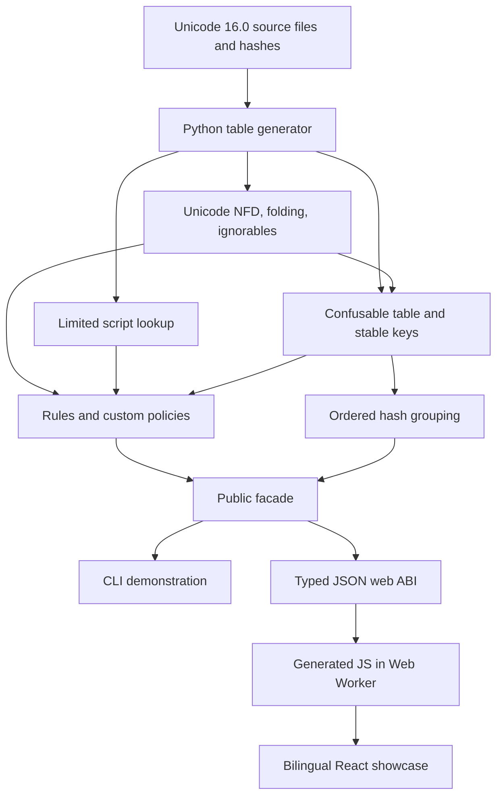

# MoonSpoof architecture

[Chinese](ARCHITECTURE_zh.md)

The root package is a stable facade over five pure MoonBit packages. The browser ABI serializes this same engine into JSON; React supplies presentation and lifecycle management. Browser execution uses the JavaScript target in a dedicated worker. WASM and native remain separate compiler targets.

## Responsibilities

| Boundary | Responsibility |
| --- | --- |
| src/unicode | Pinned NFD, combining classes, full default folding, ignorable ranges, bidi detection |
| src/script | Script property binary search, first-recognized primary script, restriction estimates |
| src/confusable | Table lookup, application extensions, stable sensitive and folded keys |
| src/security | Structured character evidence, risk rules, configurable identifier checks |
| src/batch | Shared key-based grouping; first-seen group and member order |
| src/bindings/web | Core JSON serialization, common report schema, exported string ABI |
| playground/src/engine | Request validation, worker dispatch, correlation, timeout and retry lifecycle |
| playground/src/components | Controlled inputs and display of actual engine results |

NFD decompositions are flattened by the generator. Hangul decomposition is algorithmic. Combining marks within each starter segment are stably ordered by bounded combining-class buckets, avoiding quadratic insertion sorting on long combining sequences. Lookup tables use binary search. Skeleton mapping and folding repeat until the application key is stable; see [scope and compatibility](SPECIFICATION.md).

Batch computation builds one hash bucket per key rather than comparing every pair. Cost depends on total input codepoints, table searches, decomposition expansion and stabilization passes; it is not a constant-time operation per name. An explicit first-seen key array makes output deterministic across map implementations. Identical duplicate entries are retained.

## Build and browser lifecycle

`tools/build-engine.mjs` compiles `src/bindings/web` with `moon build --target js --release` and copies the generated module into ignored `playground/src/generated/`. Both dev and production scripts regenerate it. No checked-in compiled engine can silently become stale.

The UI creates one EngineClient. It lazily boots a module worker, waits for its ready signal, and associates replies with request IDs. Startup and request deadlines are 30 seconds. A startup, transport, or timeout failure rejects pending requests and terminates the worker; a later retry creates another worker. Components match results to current inputs and discard obsolete completions. Switching tools or language preserves entered values. All tab panels remain mounted with unique input IDs and hidden inactive content.

The worker accepts only compare, inspect and batch operations. Demo limits are 512 codepoints per identifier, 5,000 batch entries and 200,000 UTF-16 units of batch text. These protect the demonstration; the pure library has no such batch cap. The default custom identifier policy allows 128 codepoints, the permissive one 256. Browser inputs never become HTML; React renders text and control characters can be escaped for evidence.

Fonts, brand logo and engine ship with the bundle. Inputs stay on the device. External documentation links navigate only when selected. The bilingual dictionary switches labels, results, rules and document language; API names and source code remain English.

## ABI and evidence

`spoof_compare(a,b)` takes two strings and returns both sensitive and folded match flags with reports for a and b. `spoof_analyze(input)` returns extended report fields. Both share one serializer. `spoof_batch_scan_with_options(input,ignore_case)` splits newline, CR and comma records, trims and skips empty records. Core JSON encoding escapes all control characters correctly.

Character targets show direct source mappings, whereas final keys pass through normalization and stabilization. The distinction is intentional. Bidi display delegates to the browser; the escaped source preserves actual logical order. The engine detects controls but does not calculate a visual-order skeleton.

Validation combines MoonBit tests on WASM, JS and native, Node tests against the freshly built ABI and worker client, official Unicode data verification, and desktop/mobile browser interaction checks. [Specification](SPECIFICATION.md) states the remaining standard gaps.
