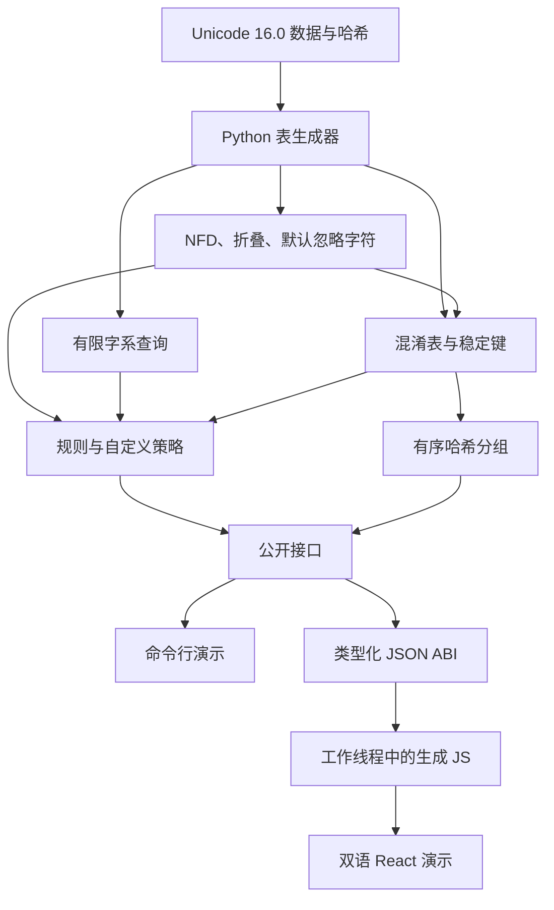

# MoonSpoof 架构

[English](ARCHITECTURE.md)

根包通过稳定接口连接五个纯 MoonBit 包。浏览器 ABI 将同一引擎序列化为 JSON，React 管理显示与生命周期。浏览器使用工作线程中的 JavaScript 编译目标；WASM 与 native 是独立编译目标。

## 职责边界

| 路径 | 职责 |
| --- | --- |
| src/unicode | 固定版本 NFD、组合类、默认完整折叠、忽略范围、双向控制检测 |
| src/script | 字系属性二分查询、首个已识别主字系、限制等级估计 |
| src/confusable | 映射表、应用扩展、稳定的敏感与折叠键 |
| src/security | 字符证据、风险规则、可配置标识符检查 |
| src/batch | 共享按键分组；保持组和成员的首次出现顺序 |
| src/bindings/web | 核心 JSON 序列化、共享报告格式、字符串 ABI |
| playground/src/engine | 请求验证、线程分发、请求关联、超时与重试 |
| playground/src/components | 受控输入与真实引擎结果显示 |

生成器展开递归规范分解，Hangul 使用算法分解。每个起始字符片段内的组合标记按有限组合类分桶稳定排序，避免长序列的二次插入排序。表查询使用二分搜索。骨架和折叠重复至应用键稳定；兼容性与标准边界见[实现范围](SPECIFICATION_zh.md)。

批量扫描每个键建立一个哈希桶，无须逐对比较。成本取决于总代码点、表查询、分解膨胀与稳定化轮数，不是每个名称常数时间。额外的首次出现键列表保证不同 Map 实现下的顺序稳定。重复的相同输入会保留。

## 构建与浏览器生命周期

`tools/build-engine.mjs` 使用 `moon build --target js --release` 编译 `src/bindings/web`，复制到被忽略的 `playground/src/generated/`。开发与生产命令都会重新生成引擎，不再依赖可能过期的已提交编译副本。

UI 创建一个 EngineClient，按需启动模块工作线程，等待就绪信号，以请求 ID 关联响应。启动和请求超时均为 30 秒。启动、传输或超时故障会拒绝等待中的请求并终止线程，重试时创建新线程。组件只显示匹配当前输入的结果，丢弃过期响应。工具与语言切换保留输入；所有面板挂载，输入 ID 唯一，非活动面板隐藏。

线程仅接受 compare、inspect、batch。演示限制每个标识符 512 码点、批次 5,000 条、批量文本 200,000 UTF-16 单元。纯库没有该批次上限。默认自定义标识符策略最多 128 码点，宽松策略最多 256。React 以文本渲染输入，不解释为 HTML；证据视图可转义控制字符。

字体、品牌 Logo 与引擎随包交付。输入留在设备本地。外部资料链接仅在点击时导航。双语字典切换标签、结果、规则与文档语言；API 名与代码保持英文。

## ABI 与证据

`spoof_compare(a,b)` 接受两个字符串，返回敏感与折叠匹配标志及双方报告。`spoof_analyze(input)` 返回扩展报告。两者共用序列化器。`spoof_batch_scan_with_options(input,ignore_case)` 按换行、CR、逗号分割，裁剪并跳过空记录。核心 JSON 编码正确转义所有控制字符。

字符目标展示直接映射，最终键经过归一化与稳定化，两者含义不同。双向视觉顺序由浏览器计算；转义源码保持逻辑顺序。引擎检测控制符，不计算视觉顺序骨架。

验证结合 WASM、JS、native 的 MoonBit 测试、新构建 ABI 与线程客户端的 Node 测试、官方 Unicode 数据验证及桌面/手机交互检查。[规范范围](SPECIFICATION_zh.md)记录尚未实现的标准部分。
